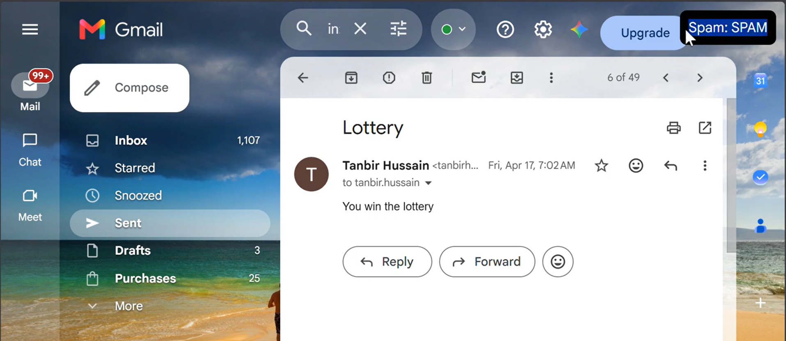
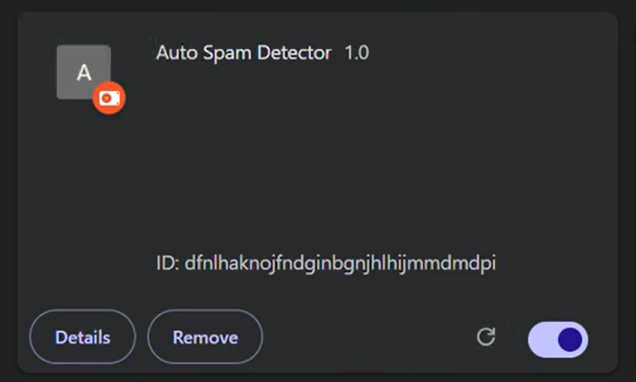

# Email Spam Extension

## Project Description

Email Spam Extension is a full-stack email spam detection system that combines a Chrome browser extension, Spring Boot backend, Flask-based Machine Learning API, and Natural Language Processing.

The browser extension automatically extracts email content from Gmail and sends it to the Spring Boot backend through a REST API. The Spring Boot backend communicates with the Flask Machine Learning service, which analyzes the email using a trained spam classification model and returns the prediction.

This project demonstrates Browser Extension Development, Backend Development, REST API Integration, Machine Learning, Natural Language Processing, and GitHub Actions (CI).

---

## Tech Stack

- Java
- Spring Boot
- Python
- Flask
- Scikit-learn
- Pandas
- NumPy
- JavaScript
- Chrome Browser Extension
- REST APIs
- Maven
- Git
- GitHub
- GitHub Actions (CI)

---

## System Architecture

```text
User
   ↓
Gmail
   ↓
Chrome Browser Extension
   ↓
Spring Boot REST API
   ↓
Flask Machine Learning API
   ↓
TF-IDF Vectorization
   ↓
Multinomial Naive Bayes Model
   ↓
SPAM / HAM Prediction
   ↓
Spring Boot
   ↓
Browser Extension
   ↓
Prediction displayed in Gmail
```

---

## Features

- Gmail browser extension for email analysis
- Automatic email content extraction
- Real-time spam/ham prediction
- Spring Boot REST API
- Flask Machine Learning API
- TF-IDF text vectorization
- Multinomial Naive Bayes classification
- Input validation
- Global exception handling
- REST API communication between Java and Python services
- GitHub Actions CI workflow

---

## Project Workflow

1. User opens an email in Gmail.
2. Chrome Extension extracts the email content.
3. Extension sends the email text to the Spring Boot backend.
4. Spring Boot validates the request.
5. Spring Boot sends the email text to the Flask Machine Learning API.
6. Flask preprocesses the email text.
7. TF-IDF converts the text into numerical features.
8. Multinomial Naive Bayes predicts whether the email is SPAM or HAM.
9. Flask returns the prediction.
10. Spring Boot sends the result back to the browser extension.
11. The extension displays the spam detection result inside Gmail.

---

## Machine Learning Model

### Algorithm

- Multinomial Naive Bayes

### Text Processing

- Text cleaning
- Lowercase conversion
- Special-character removal
- TF-IDF Vectorization

### Dataset

- spam.csv

### Saved Model Files

- spam_model.pkl
- vectorizer.pkl

### Training

The model is trained using the train_model.py script.

The dataset is divided into training and testing sets, and the trained model and TF-IDF vectorizer are saved for use by the Flask API.

---

## Screenshots

### Gmail Spam Detection



### Extension UI



---

## Project Structure

```text
email-spam-extension/
│
├── .github/
│   └── workflows/
│       └── ci.yml
│
├── email-extension/
│   ├── content.js
│   └── manifest.json
│
├── sts/
│   ├── src/
│   │   └── main/
│   │       ├── java/
│   │       │   └── com/scs/emailthreat/
│   │       │       ├── controller/
│   │       │       │   └── EmailController.java
│   │       │       ├── dto/
│   │       │       │   ├── EmailRequestDTO.java
│   │       │       │   └── EmailResponseDTO.java
│   │       │       ├── exception/
│   │       │       │   └── GlobalExceptionHandler.java
│   │       │       ├── service/
│   │       │       │   └── EmailService.java
│   │       │       └── SmartEmailThreatDetectionSystemApplication.java
│   │       │
│   │       └── resources/
│   │
│   ├── pom.xml
│   ├── mvnw
│   └── mvnw.cmd
│
├── app.py
├── train_model.py
├── spam.csv
├── spam_model.pkl
├── vectorizer.pkl
├── requirements.txt
└── README.md
```

---

## Setup Instructions

### Clone Repository

```bash
git clone https://github.com/tanbir-hsain/email-spam-extension.git
cd email-spam-extension
```

---

### Machine Learning Service

Install Python dependencies:

```bash
pip install -r requirements.txt
```

Run the Flask application:

```bash
python app.py
```

---

### Backend

Navigate to the Spring Boot project:

```bash
cd sts
```

Run the application:

```bash
./mvnw spring-boot:run
```

On Windows:

```bash
mvnw.cmd spring-boot:run
```

The Spring Boot backend runs on:

```text
http://localhost:8080
```

---

### Browser Extension

Open Google Chrome.

Navigate to:

```text
chrome://extensions/
```

Enable Developer Mode.

Select Load unpacked.

Select the email-extension folder.

Open Gmail and open an email.

The extension sends the email content to the backend for analysis.

---

## API Endpoint

### Analyze Email

```http
POST /email/analyze
```

### Request

```json
{
  "emailText": "Congratulations! You won a lottery."
}
```

### Response

```json
{
  "result": "SPAM",
  "confidence": 1.0
}
```

The current Spring Boot service returns a confidence value of 1.0 rather than the actual confidence score from the Machine Learning model.

### Invalid Request

```json
{
  "result": "INVALID_INPUT",
  "confidence": 0.0
}
```

---

## CI / GitHub Actions

The project uses GitHub Actions for Continuous Integration.

The CI workflow automatically checks the project whenever changes are pushed to GitHub.

The workflow includes checks for:

- Python environment
- Python dependencies
- Java/Maven project
- Build validation

This helps ensure that changes pushed to the repository do not break the project.

---

## Skills Demonstrated

- Java
- Spring Boot
- Python
- Flask
- REST API Development
- Machine Learning
- Natural Language Processing
- Scikit-learn
- TF-IDF
- Naive Bayes
- Chrome Extension Development
- API Integration
- Maven
- Git & GitHub
- GitHub Actions (CI)
- Full-Stack Development

---

## Future Improvements

- Deploy Spring Boot and Flask services to AWS
- Replace localhost APIs with cloud endpoints
- Improve spam classification accuracy with larger datasets
- Add automated unit and integration tests
- Add confidence scoring from the Machine Learning model
- Improve Gmail UI integration
- Support multiple email providers
- Add Continuous Deployment (CD)

---

## Demo Video

Watch the Email Spam Extension demo:

[**Email Spam Extension — Watch Demo on YouTube**](https://youtu.be/5glKjS0X9h8)

---

## Author

**Tanbir Hussain**

GitHub

https://github.com/tanbir-hsain/email-spam-extension

LinkedIn

https://www.linkedin.com/in/tanbir-hussain-76320b414